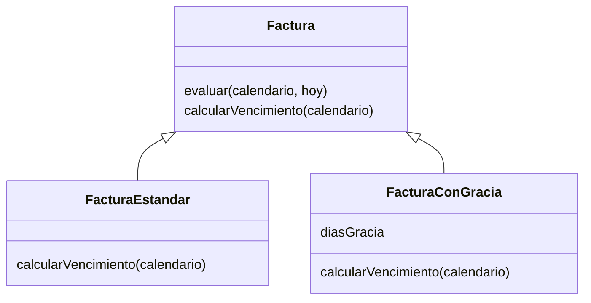

# Extensión del Laboratorio 1: herencia y polimorfismo

Se elige el Reto 1 de Laboratorio1_Extension.docx. El documento permite uno o varios retos y recomienda no intentar los cuatro al mismo tiempo. Esta entrega incorpora el primero a la solución base funcional.

`Factura` valida los datos y decide el estado en `evaluar`. El método invoca `this.calcularVencimiento(calendario)`. Cuando el objeto es una hija, JavaScript ejecuta su implementación sobreescrita.

`FacturaEstandar` calcula exclusivamente el plazo contractual, conservando la regla original. `FacturaConGracia` utiliza `super.calcularVencimiento` para obtener esa fecha y añade de uno a cinco días hábiles de gracia con el mismo calendario. El constructor de cada hija llama `super(datos)` y valida sus restricciones particulares. Los días de gracia son privados y se consultan por un getter.

`crearFactura` selecciona la clase una vez, al construir el objeto. Después, el código consumidor llama el mismo método sin un IF por tipo. La clase fábrica no reemplaza el polimorfismo: únicamente realiza la selección inicial. Si un registro anterior no indica tipo, se conserva el comportamiento estándar.

El diagrama vectorial listo para usar está en `docs/jerarquia.svg`.

## Ejemplo

Ambas facturas se emiten el jueves 15 de octubre de 2026, con un plazo contractual de un día hábil.

| Tipo | Vencimiento | Estado al 19 de octubre |
|---|---|---|
| Estándar | Viernes 16 de octubre | Vencida |
| Con dos días hábiles de gracia | Martes 20 de octubre | Pendiente |

El fin de semana no consume gracia. Esta diferencia puede comprobarse con `npm run demo:polimorfismo`. FAC-005 incluye el segundo caso en JSON Server y n8n.

## Integración en el workflow

`prepararFacturas` crea la hija adecuada para validar antes de llamar a la API. `procesarFactura` vuelve a construir esa hija con los datos recibidos y llama a `evaluar`. `scripts/build-workflow.js` incorpora el archivo completo al Code: no existe otra jerarquía ni algoritmo mantenidos manualmente.

## Errores nuevos

- `TIPO_INVALIDO`: tipo diferente de estandar o con_gracia.
- `GRACIA_INVALIDA`: falta el valor o no es un entero entre 1 y 5.
- `GRACIA_NO_APLICA`: una factura estándar declara gracia distinta de cero.

Los errores terminan en la rama sin escritura para el registro afectado. Una factura con gracia conserva las reglas de fechas, país, monto, calendario y estados del modelo base.

La gracia es una condición comercial del ejemplo. No se aplican intereses ni cambios legales; la solución usa el vencimiento efectivo para clasificar el atraso. Una factura ya vencida no se reabre por agregar gracia después de procesarla.
